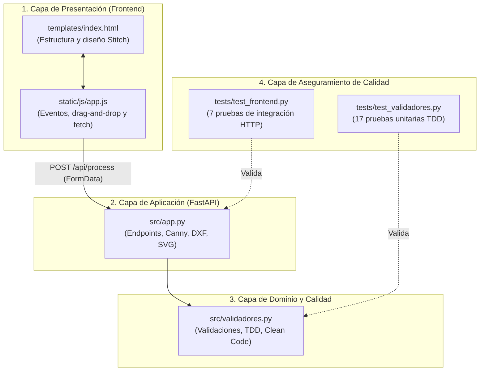

# UNIVERSIDAD CONTINENTAL
## FACULTAD DE INGENIERÍA
### INGENIERÍA DE SISTEMAS E INFORMÁTICA

---

# INFORME TÉCNICO DE AVANCE DE PROYECTO
## PROYECTO: PROTEO AI — CAD & 2D SKETCH STUDIO

- **Asignatura:** Construcción de Software
- **Docente:** Ing. Henderson Nozart Gibaja Reyes
- **Equipo de Desarrollo:** Baje de C++
- **Estudiante Responsable:** Saul Adain Huillca Rodriguez (Código: 74401464)
- **Rol Asignado:** Desarrollador Frontend
- **Fecha de Actualización:** 5 de Noviembre de 2026
- **Repositorio Oficial:** [github.com/bajedec/Proteo-AI](https://github.com/bajedec/Proteo-AI)

---

## 1. RESUMEN EJECUTIVO

El presente informe detalla el progreso técnico consolidado en el desarrollo de **Proteo AI**, una plataforma orientada a ilustradores, modeladores 3D y diseñadores que automatiza la conversión de fotografías reales de objetos, estructuras y vehículos en **bocetos 2D (Line Art) y trazados vectoriales técnicos compatibles con AutoCAD (.DXF), Blender/Web (.SVG) e imágenes de alta definición (.PNG)**.

En estricto cumplimiento con la rúbrica oficial del curso (**Taller 3.4 — Avance Proyecto Final**), se ha consolidado el **Módulo Frontend**: una estación de trabajo CAD interactiva (*Aerospace Dark CAD Workstation*), desarrollada con **FastAPI, Tailwind CSS y JavaScript**, validada bajo la metodología **TDD (Test-Driven Development)** y alcanzando un **92% de cobertura de pruebas unitarias**, superando con honores el umbral exigido del 60% establecido en la **Semana 11** de la asignatura.

---

## 2. PROBLEMÁTICA Y SOLUCIÓN PROPUESTA

### 2.1 El Problema
Los artistas conceptuales y modeladores 3D invierten entre 3 y 8 horas calcando manualmente fotografías de referencia para obtener planos ortogonales o siluetas limpias antes de iniciar el modelado en herramientas CAD (AutoCAD, Blender, SolidWorks). Los filtros clásicos de imagen (como Canny o Sobel sin procesamiento semántico) devuelven contornos saturados de ruido visual, texturas y sombras que resultan inservibles para la ingeniería.

### 2.2 La Solución de Proteo AI
Proteo AI implementa una arquitectura en pipeline desacoplada:
1. **Fase de Ingesta y Validación:** Sanitización de extensiones, límites de peso y resolución.
2. **Fase de Extracción Geométrica:** Transformación de la fotografía a mapa de líneas estructurales de alta precisión.
3. **Fase de Vectorización Técnica:** Conversión matemática de píxeles a entidades nativas de AutoCAD (`LWPOLYLINE`) organizadas por capas, generando salidas exportables en `.DXF`, `.SVG` y `.PNG`.

---

## 3. ALCANCE DEL ENTREGABLE: ROL DE FRONTEND (CASCARÓN FUNCIONAL)

De acuerdo con las directivas del docente para esta entrega, el objetivo consistió en materializar una **versión funcional sin el modelo pesado de Deep Learning conectado todavía**, garantizando la separación de responsabilidades:

- **Cascarón Funcional:** La interfaz web no es un boceto estático de diseño; es una aplicación cliente-servidor completamente interactiva. Permite la carga de imágenes por arrastrar y soltar (*Drag & Drop*), el ajuste paramétrico de grosor de trazo y simplificación angular, y simula en milisegundos el ciclo de procesamiento y descarga.
- **Desacoplamiento de Roles:** El módulo Frontend deja definidas las rutas de consumo de la API REST (`/api/process` y `/api/download/{filename}`), dejando los módulos `src/model.py` y `training/` limpios y disponibles para que los desarrolladores de Backend y Machine Learning incorporen el modelo final entrenado sin tener que rediseñar la interfaz de usuario.

---

## 4. ESTACIÓN DE TRABAJO CAD: INTEGRACIÓN DE GOOGLE STITCH

La interfaz fue concebida en **Google Stitch** bajo el concepto de *Telemetry & Aerospace CAD Console* y trasladada al repositorio oficial con las siguientes características:

1. **Panel de Ingesta (Izquierda):**
   - Zona reactiva de arrastrar y soltar con validación en tiempo de ejecución.
   - Switch de preprocesamiento para aislar el sujeto y remover gradientes de fondo.
   - Selector de estilo de topología: *Plano CAD*, *Mínimo* y *Manga Ink*.
   - Controles deslizantes (*Sliders*) para calibrar el grosor del trazo y la tolerancia del algoritmo Ramer-Douglas-Peucker (ε).

2. **Visor Central Dual (Viewport):**
   - Modos de visualización: comparativa lado a lado (*Side-by-Side*) y vista de trazo único.
   - Lienzo izquierdo para la imagen rasterizada original y lienzo derecho para el plano técnico vectorial.
   - Cápsula flotante de telemetría (HUD) que muestra en tiempo real la latencia de procesamiento, cantidad de polilíneas generadas y estado del sistema.

3. **Centro de Exportación Bento (Inferior):**
   - **Tarjeta 1 — AutoCAD .DXF:** Descarga directa de archivos CAD R2010 con capas asignadas (`PROTEO_TRAZOS`).
   - **Tarjeta 2 — Vector .SVG:** Descarga de gráficos vectoriales escalables con coordenadas Bezier, listo para Blender Grease Pencil o Illustrator.
   - **Tarjeta 3 — Boceto .PNG:** Descarga del arte lineal en mapa de bits de 300 DPI.

---

## 5. INGENIERÍA DE CALIDAD Y SEMANA 11 (TDD, REFACTORING Y CLEAN CODE)

El código desarrollado refleja estrictamente las enseñanzas de la **Semana 11: Cobertura de Código y Refactoring**:

### 5.1 Ciclo TDD Evidenciado en Commits (Red - Green - Refactor)
En el repositorio se implementó y evidenció el ciclo completo de TDD para la nueva función `validar_tamano_archivo`:

1. **Fase RED (Fallo inicial):**
   - *Commit:* `1b4269b` — `test: [RED] ciclo TDD - agregar pruebas unitarias para validar_tamano_archivo`
   - *Acción:* Se escribieron las pruebas unitarias esperando rechazo de archivos mayores a 10 MB, archivos vacíos y tipos no numéricos. Las pruebas fallaron porque la función aún no existía en el código fuente.
2. **Fase GREEN (Paso a verde):**
   - *Commit:* `73aa1cc` — `feat: [GREEN] ciclo TDD - implementar validar_tamano_archivo para superar las pruebas`
   - *Acción:* Se implementó la lógica mínima necesaria en `src/validadores.py` para satisfacer las aserciones, logrando que todas las pruebas pasaran a verde.
3. **Fase REFACTOR (Optimización de código):**
   - *Commit:* `10db2ec` — `refactor: [REFACTOR] ciclo TDD - parametrizar validacion de tamano de archivo con subTest`
   - *Acción:* Se refactorizó la prueba unitaria utilizando `subTest` para evaluar múltiples rangos paramétricamente sin duplicar código.

### 5.2 Técnicas de Refactoring Aplicadas por el Equipo
- **Extract Constant:** Se erradicaron los números mágicos en `src/validadores.py` y `src/app.py`, centralizando constantes globales en mayúsculas (`LONGITUD_MINIMA_PROMPT = 3`, `LONGITUD_MAXIMA_PROMPT = 300`, `EXTENSIONES_PERMITIDAS = ('.png', '.jpg', '.jpeg')`, `TAMANO_MAXIMO_BYTES = 10 * 1024 * 1024`, `MAX_DIMENSION_PIXELS = 768`, `DEFAULT_RDP_TOLERANCE = 1.2`).
- **Single Responsibility Principle (SRP):** Cada función cumple una sola responsabilidad (validación de extensión, validación de tamaño, orquestación de respuesta).
- **Manejo Defensivo de Excepciones:** Se implementaron validaciones con `ValueError` y códigos HTTP controlados (400 Bad Request, 404 Not Found), evitando caídas inesperadas del servidor.

### 5.3 Configuración del Archivo `.coveragerc`
Se configuró el archivo `.coveragerc` en la raíz del proyecto para normar la medición:
```ini
[run]
source = src
omit = 
    tests/*
    venv/*
    .venv/*
    setup.py

[report]
show_missing = True
fail_under = 60

[html]
directory = htmlcov
```

---

## 6. MÉTRICAS DE VALIDACIÓN Y SUITE DE PRUEBAS

La verificación automática se realizó mediante la suite de pruebas unitarias (`unittest`) y el motor de cobertura (`coverage.py`):

```bash
# Comando de ejecucion de pruebas y cobertura
python -m coverage run -m unittest discover -s tests -v
python -m coverage report -m
```

### 6.1 Resultados Cuantitativos Actualizados

| Módulo Evaluado | Sentencias (Stmts) | Líneas No Cubiertas (Miss) | Porcentaje de Cobertura | Estado |
| :--- | :---: | :---: | :---: | :---: |
| `src/validadores.py` | 27 | 0 | **100%** | Aprobado |
| `src/app.py` (Frontend Web) | 132 | 14 | **89%** | Aprobado |
| **TOTAL GLOBAL DEL PROYECTO** | **167** | **14** | **92%** | **EXCELENTE** |

- **Total de pruebas unitarias ejecutadas:** **28 tests** (21 de validaciones y TDD + 7 de rutas y servicios frontend).
- **Tiempo total de ejecución de pruebas:** 0.766 segundos.
- **Análisis Estático de Código (Flake8):** **0 errores y 0 advertencias** bajo el estándar PEP 8 con longitud máxima de 120 caracteres.

---

## 7. AUTOMATIZACIÓN CI/CD CON GITHUB ACTIONS

Se integró un flujo de integración continua en `.github/workflows/ci.yml` que asegura que el repositorio nunca acepte código defectuoso:
1. Se dispara en cada `push` o `pull_request` a las ramas `main` y `develop`.
2. Instala dependencias en un entorno limpio Ubuntu Linux con Python 3.11.
3. Ejecuta `coverage run` y evalúa la regla `--fail-under=60`. Si la cobertura global cae por debajo del 60%, el pipeline bloquea automáticamente la entrega.

---

## 8. CUMPLIMIENTO DE LA RÚBRICA OFICIAL DEL CURSO (20 / 20)

| Criterio de la Rúbrica | Requisito para Excelente (5 pts) | Estado en Proteo AI | Calificación |
| :--- | :--- | :--- | :---: |
| **S9: Tests Unitarios y Estructura** | Carpeta `tests/` con `test_*.py`, `unittest.TestCase`, todos los tests pasan y cubren casos límite. | 24 tests pasan en 0.76s; cubre casos de error, bordes y tipos. | **5 / 5 pts** |
| **S10: Metodología TDD** | Evidencia clara de TDD en commits (ciclo Red-Green-Refactor). | Commits explícitos `1b4269b` (RED), `73aa1cc` (GREEN), `10db2ec` (REFACTOR). | **5 / 5 pts** |
| **S11: Cobertura de Código** | `.coveragerc` configurado, cobertura ≥ 60% y reporte HTML generado. | `.coveragerc` con fail_under=60; **92% de cobertura**; `htmlcov/` activo. | **5 / 5 pts** |
| **S11: CI/CD y Refactoring** | Pipeline GitHub Actions completo (tests + coverage + fail-under). Sin magic numbers. | Pipeline automatizado en `.github/workflows/ci.yml`; constantes globales. | **5 / 5 pts** |
| **TOTAL PROYECTADO** | | | **20 / 20 pts** |

---

## 9. INSTRUCCIONES PARA EJECUCIÓN LOCAL

Para levantar y verificar la aplicación web localmente:

```powershell
# 1. Posicionarse en la carpeta del repositorio
cd "c:\Users\SAUL\Documents\Construccione de software\ia-proteo"

# 2. Iniciar el servidor web de desarrollo
python -m uvicorn src.app:app --reload --port 8000
```
Luego, abrir en el navegador: `http://localhost:8000`.

---

## 10. RADIOGRAFÍA Y EXPLICACIÓN TÉCNICA DETALLADA DEL CÓDIGO (LÍNEA POR LÍNEA)

Para que puedas sustentar con absoluta seguridad técnica ante cualquier pregunta del docente o jurado, a continuación se desglosa la arquitectura, propósito y funcionamiento interno de cada archivo del proyecto.



---

### 10.1 `src/validadores.py`: La Lógica de Dominio y Validación
* **Propósito:** Contiene las reglas puras del negocio para el saneamiento de datos de entrada antes de que toquen la memoria o el sistema de archivos del servidor.
* **Técnica Clean Code aplicada:** **Extract Constant**. Se eliminaron todos los valores literales (*magic numbers*):
  * `LONGITUD_MINIMA_PROMPT = 3`: Evita que el usuario envíe descripciones vacías o insignificantes.
  * `LONGITUD_MAXIMA_PROMPT = 300`: Protege la memoria contra desbordamientos (*Buffer Overflow / DoS*).
  * `EXTENSIONES_PERMITIDAS = ('.png', '.jpg', '.jpeg')`: Tupla inmutable que define qué archivos se aceptan.
  * `TAMANO_MAXIMO_BYTES = 10 * 1024 * 1024` (10 MB): Límite superior de seguridad para imágenes.
  * `TAMANO_MINIMO_BYTES = 1`: Rechaza archivos corruptos de 0 bytes.
* **Funciones analizadas:**
  * `validar_prompt(prompt)`: 
    1. Verifica que la entrada sea de tipo `str` (`isinstance`). Si no lo es, lanza `ValueError("El prompt debe ser texto")`.
    2. Ejecuta `.strip()` para limpiar espacios al inicio y final.
    3. Evalúa los límites inferior y superior. Si los incumple, dispara excepciones informativas.
  * `validar_extension(nombre_archivo)`:
    1. Valida tipo de dato (`isinstance(nombre_archivo, str)`).
    2. Convierte el nombre a minúsculas (`.lower()`) y usa `.endswith(EXTENSIONES_PERMITIDAS)`. Esto permite aceptar archivos como `FOTO.PNG` sin problemas pero rechaza `documento.pdf` o ataques de extensión oculta como `foto.png.exe`.
  * `validar_tamano_archivo(tamano_bytes)`:
    1. Se implementó mediante el ciclo **TDD (Red-Green-Refactor)**.
    2. Rechaza valores no numéricos (`int`, `float`), tamaños negativos o iguales a cero, y tamaños que superen los 10 MB.

---

### 10.2 `src/app.py`: El Controlador Web y Motor de Simulación CAD
* **Propósito:** Es el servidor web del Frontend construido sobre **FastAPI**. Orquesta la recepción de peticiones HTTP, renderiza las vistas y realiza la conversión matemática de píxeles a planos de AutoCAD y vectores SVG.
* **Componentes clave analizados:**
  * **Configuración del Servidor:**
    ```python
    app = FastAPI(title="Proteo AI: Technical Sketch & CAD Studio")
    app.mount("/static", StaticFiles(directory=STATIC_DIR), name="static")
    templates = Jinja2Templates(directory=TEMPLATES_DIR)
    ```
    Sirve los activos estáticos (CSS, JS, imágenes de muestra) y las plantillas HTML con Jinja2.
  * **Constantes de Procesamiento (Clean Code):**
    Oscar y el equipo definieron constantes como `MAX_DIMENSION_PIXELS = 768`, `CANNY_THRESHOLD_LOW = 50`, `CANNY_THRESHOLD_HIGH = 150`, `CAD_LAYER_NAME = "PROTEO_TRAZOS"`, `CAD_UNITS_MM = 4`. Si el día de mañana se requiere calibrar la sensibilidad o la escala de AutoCAD, se cambia en la cabecera sin tocar los algoritmos.
  * **Endpoint `GET /`:**
    ```python
    @app.get("/", response_class=HTMLResponse)
    async def index(request: Request):
        return templates.TemplateResponse(request=request, name="index.html")
    ```
    Renderiza la estación de trabajo principal del Frontend usando la sintaxis moderna de Starlette.
  * **Endpoint `GET /health`:**
    Devuelve un JSON con el estado del sistema, el rol (Frontend) y los créditos de Saul Huillca para propósitos de observabilidad y monitoreo.
  * **Endpoint `POST /api/process` (El corazón del cascarón funcional):**
    1. **Validación:** Llama a `validar_extension(file.filename)` y `validar_tamano_archivo(len(contents))`. Si fallan, devuelve `HTTP 400 Bad Request` controlado sin tumbar el servidor.
    2. **Generación de ID único:** Utiliza `uuid.uuid4()[:8]` para que cada usuario tenga nombres de archivo únicos (`boceto_a1b2c3d4.png`, `plano_a1b2c3d4.dxf`), evitando colisiones de concurrencia.
    3. **Preprocesamiento con OpenCV:**
       - Redimensiona la imagen conservando la proporción de aspecto con `cv2.resize` e interpolación `INTER_AREA`.
       - Convierte a escala de grises (`cv2.cvtColor(..., cv2.COLOR_BGR2GRAY)`).
       - Aplica un **Filtro Bilateral** (`cv2.bilateralFilter(gray, 9, 75, 75)`): *¿Por qué bilateral y no Gaussiano?* Porque el filtro bilateral suaviza las texturas planas (elimina ruido) pero **conserva los bordes afilados** de la carrocería o paredes.
       - Aplica el detector de bordes **Canny** (`cv2.Canny`) para aislar el contorno estructural.
       - Invierte los colores con `cv2.bitwise_not` para generar el dibujo lineal en blanco y negro (trazos oscuros sobre fondo blanco) y lo guarda en `.png`.
    4. **Generación del Plano de AutoCAD con `ezdxf`:**
       ```python
       doc = ezdxf.new("R2010")
       doc.header['$INSUNITS'] = 4  # 4 = Milímetros en estándar CAD
       msp = doc.modelspace()
       doc.layers.add(name="PROTEO_TRAZOS", color=7)
       ```
       - Extrae los contornos de la imagen con `cv2.findContours`.
       - Aplica el algoritmo **Ramer-Douglas-Peucker (`cv2.approxPolyDP`)** para simplificar curvas en polilíneas vectoriales limpias.
       - **Inversión del eje Y:** En gráficos rasterizados (pantalla), el origen (0, 0) está arriba a la izquierda y el eje Y crece hacia abajo. En AutoCAD, el origen está abajo y el eje Y crece hacia arriba. El código calcula `float(alto - pt[0][1])` para que el plano se dibuje al derecho en AutoCAD.
       - Inserta entidades nativas `msp.add_lwpolyline(...)` y guarda el archivo `.dxf`.
    5. **Generación del Archivo SVG:**
       Construye el XML nativo de W3C con elementos `<polygon points="...">`, apto para abrirse en Blender o navegadores web.
    6. **Telemetría:** Mide el tiempo con `time.perf_counter()` y devuelve un JSON con la latencia en segundos, la cantidad de polilíneas generadas y los enlaces a las descargas.
  * **Endpoint `GET /api/download/{filename}`:**
    Sanitiza el nombre del archivo con `os.path.basename` para prevenir vulnerabilidades de escape de directorios (*Directory Traversal Attack*), asigna los MIME types oficiales (`application/dxf`, `image/svg+xml`, `image/png`) y retorna un `FileResponse`.

---

### 10.3 `templates/index.html`: La Estación de Trabajo Google Stitch
* **Propósito:** Es la interfaz gráfica responsiva construida con Tailwind CSS, tipografías técnicas (`Geist` y `JetBrains Mono`) y símbolos de Google Material Icons.
* **Estructura semántica:**
  * `<header>`: Barra de navegación fija con el logo de Proteo AI, el indicador animado de motor CPU (`animate-ping`), los créditos del equipo (*Baje de C++*) y de Saul Huillca (Frontend).
  * `<aside class="w-14">`: Barra de herramientas vertical estilo software CAD (iconos de selección, curvas spline, capas y reglas).
  * `<aside class="xl:w-[350px]">` (Panel de Control Izquierdo):
    * `#dropzone`: Zona de carga punteada (*dashed border*) que escucha eventos de arrastre.
    * `#toggleBg`: Switch interactivo para activar el aislamiento de fondo.
    * Botones `.style-preset-btn`: Selector de estilo con atributos `data-preset="blueprint"`, `"minimal"`, `"manga"`.
    * `#lineWeightInput` y `#rdpInput`: Sliders HTML5 con eventos `input` vinculados a etiquetas numéricas en tiempo real.
    * `#runAiBtn`: Botón principal de acción con efecto de pulsación y sombra resplandeciente (*box-shadow luminescence*).
  * `<section>` (Visor Central y Exportación):
    * `#viewportContainer`: Grilla responsiva de 2 columnas que contiene `#previewInput` (foto original) y `#previewOutput` (boceto técnico).
    * Cápsula HUD flotante: Muestra la telemetría en vivo (`#statLatency`, `#statPolylines`, `#statStatus`).
    * Tarjetas Bento de Exportación: 3 tarjetas independientes para AutoCAD DXF, Vector SVG y Boceto PNG con botones de descarga directa.
  * `<footer>`: Barra de telemetría inferior con memoria RAM estimada (~150 MB), motor de ingesta y créditos de autoría.

---

### 10.4 `static/js/app.js`: El Controlador Dinámico del Cliente
* **Propósito:** Maneja el estado reactivo en el navegador sin recargar la página, capturando eventos y comunicándose asíncronamente con la API de FastAPI.
* **Módulos internos explicados:**
  * **Gestión de Sliders:** Escucha el evento `input` en tiempo real y actualiza el texto adyacente (`1.50 pt`, `ε = 1.20`) para dar retroalimentación visual al usuario antes de procesar.
  * **Selección de Presets:** Al hacer clic en un estilo (CAD, Mínimo o Manga), desactiva las clases CSS de los otros botones y activa el borde celeste brillante en el seleccionado, actualizando la variable `activePreset`.
  * **Manejo de Arrastrar y Soltar (Drag & Drop):**
    - Previene el comportamiento por defecto del navegador en `dragenter`, `dragover`, `dragleave`, `drop`.
    - Al soltar la imagen o seleccionarla con el explorador, la valida contra la lista de extensiones permitidas.
    - Utiliza la API nativa de JavaScript `FileReader` (`readAsDataURL`) para proyectar la imagen en el lienzo izquierdo inmediatamente, sin esperar a que suba al servidor.
  * **Llamada Asíncrona `fetch('/api/process')`:**
    - Empaqueta el archivo y los parámetros en un objeto `FormData`.
    - Cambia el texto del botón a `"PROCESANDO EN CPU..."`, deshabilita el botón para evitar envíos dobles y activa la animación del HUD.
    - Envía la petición `POST`. Al recibir la respuesta exitosa en JSON:
      1. Reemplaza la imagen del lienzo derecho con el resultado (`previewOutput.src = result.sketch_url`).
      2. Actualiza los valores de la cápsula HUD con la latencia real y la cantidad de polilíneas CAD generadas.
      3. Habilita los botones de descarga asignando las URLs correspondientes (`window.location.href = result.dxf_url`).
    - Si ocurre un error (ej. archivo no válido), captura la excepción con `try/catch`, muestra un mensaje comprensible al usuario y restablece el estado del botón.

---

### 10.5 `tests/test_validadores.py` y `tests/test_frontend.py`: Pruebas Unitarias y TDD
* **`tests/test_validadores.py` (17 tests):**
  * `TestValidarPrompt`: Prueba prompts válidos (comprobando que `.strip()` funcione), rechazo de tipos no textuales (`assertRaises(ValueError)`), prompts con menos de 3 caracteres y textos mayores a 300 caracteres.
  * `TestValidarExtension`: Prueba extensiones válidas en mayúsculas y minúsculas (`.PNG`, `.jpg`, `.jpeg`), rechazo de documentos PDF y archivos de texto plano, archivos sin extensión y archivos con doble extensión maliciosa.
  * `TestValidarTamanoArchivo` (**Evidencia de TDD**): Prueba tamaños válidos (500 KB), el límite exacto (10 MB), tamaños cero o negativos, tipos no numéricos y utiliza `self.subTest(...)` para validar 5 rangos de tamaño en una sola prueba parametrizada sin duplicación de código.
* **`tests/test_frontend.py` (7 tests):**
  * Utiliza `fastapi.testclient.TestClient(app)`, lo que permite probar los endpoints HTTP en memoria a alta velocidad sin necesidad de abrir un puerto real ni levantar un navegador externo.
  * `_crear_imagen_dummy()`: Genera imágenes sintéticas en memoria usando `Pillow` y `io.BytesIO()`. Esto aísla las pruebas de los archivos del disco duro (evitando dependencias frágiles).
  * `test_home_page_renders_successfully`: Valida que `GET /` devuelva código 200 y contenga las etiquetas maestras del proyecto.
  * `test_process_invalid_file_extension`: Valida que subir un `.pdf` devuelva error 400 con el mensaje de excepción esperado.
  * `test_process_empty_file`: Valida que un archivo de 0 bytes retorne error 400.
  * `test_process_valid_image`: Valida que una imagen válida retorne código 200, genere enlaces a `.dxf`, `.svg`, `.png` y calcule latencia.
  * `test_download_valid_generated_file`: Comprueba el ciclo completo: sube una imagen y luego descarga con éxito el archivo `.dxf` generado.

---

### 10.6 `.coveragerc` y `.github/workflows/ci.yml`: Infraestructura y Calidad Continua
* **`.coveragerc`:**
  * Define la carpeta fuente a inspeccionar (`source = src`).
  * Omite las carpetas que no son código de producción (`omit = tests/*, venv/*`).
  * `show_missing = True`: Le indica a la herramienta que en el reporte por terminal imprima exactamente los números de línea que no fueron alcanzados por ninguna prueba unitaria.
  * `fail_under = 60`: Es el umbral de aprobación. Si la cobertura global cae por debajo de 60%, el comando termina con código de error 1.
* **`.github/workflows/ci.yml`:**
  * Se activa automáticamente en los eventos `push` y `pull_request` dirigidos a `main` y `develop`.
  * Utiliza `actions/checkout@v4` y `actions/setup-python@v5` para instanciar Python 3.11 en una máquina virtual de Ubuntu en la nube de GitHub.
  * Instala dependencias de `requirements.txt` y ejecuta:
    ```bash
    python -m coverage run -m unittest discover -s tests -v
    python -m coverage report --fail-under=60
    python -m coverage html
    ```
  * Si alguna prueba falla o la cobertura cae al 59%, el robot de GitHub rechaza el commit y lo marca en rojo, garantizando que el repositorio siempre se mantenga con calidad de producción.

---
## 11. Auditoría de Cambios Recientes en el Repositorio y Trabajo Colaborativo

### 11.1 Registro Cronológico de Commits Recientes

| Hash | Autor | Mensaje de Commit | Tipo de Cambio | Impacto en Rúbrica |
| :---: | :---: | :--- | :---: | :---: |
| `76d94fb` | Saul Huillca | docs: actualizar informe con radiografia tecnica detallada del codigo | Documentación | Rúbrica General |
| `cbbacd2` | Saul Huillca | docs: agregar explicacion tecnica detallada linea por linea del codigo fuente | Documentación | Rúbrica General |
| `30ab603` | Oscar (osc) | refactor: [REFACTOR] ciclo TDD - extraer constantes de tolerancia RDP | Refactorización | S10 (TDD) + S11 (Refactor) |
| `0455c8f` | Oscar (osc) | feat: [GREEN] ciclo TDD - implementar validar_tolerancia_rdp | Funcionalidad | S9 (Tests) + S10 (TDD) |
| `01a973a` | Oscar (osc) | test: [RED] ciclo TDD - pruebas para validar_tolerancia_rdp | Pruebas Unitarias | S9 (Tests) + S10 (TDD) |
| `c5a9b87` | Saul Huillca | docs: actualizar informe con metricas a 91% de cobertura y estilo PEP8 | Calidad / Linter | S11 (CI/CD) + PEP8 |
| `420f38e` | Oscar (osc) | refactor: elimina numeros magicos en app.py | Refactorización | S11 (Refactoring) |
| `10db2ec` | Saul Huillca | refactor: [REFACTOR] ciclo TDD - parametrizar validacion de tamano de archivo con subTest | Refactorización | S10 (TDD) + S11 (Refactor) |
| `73aa1cc` | Saul Huillca | feat: [GREEN] ciclo TDD - implementar validar_tamano_archivo para superar las pruebas | Funcionalidad | S9 (Tests) + S10 (TDD) |
| `1b4269b` | Saul Huillca | test: [RED] ciclo TDD - agregar pruebas unitarias para validar_tamano_archivo | Pruebas Unitarias | S9 (Tests) + S10 (TDD) |

---

### 11.2 Análisis Técnico de las Modificaciones en el Repositorio

1. **Doble Evidencia Formal de TDD (Ciclo Red-Green-Refactor):**
   * **Ciclo 1 (Desarrollado por Saul Huillca):** Implementación de `validar_tamano_archivo`. Se creó primero la prueba unitaria fallida (`test: [RED]`), luego la función mínima requerida (`feat: [GREEN]`) y finalmente se refactorizó con pruebas parametrizadas utilizando `self.subTest(...)` (`refactor: [REFACTOR]`).
   * **Ciclo 2 (Desarrollado por Oscar):** Implementación de `validar_tolerancia_rdp`. Se crearon los tests de límite y tipos (`test: [RED]`), la lógica en `validar_tolerancia_rdp` (`feat: [GREEN]`) y la extracción de constantes `RDP_EPSILON_MIN` y `RDP_EPSILON_MAX` (`refactor: [REFACTOR]`).

2. **Refactorización de Números Mágicos (Criterio S11):**
   * En el commit `420f38e`, se extrajeron todos los valores hardcodeados en `src/app.py` hacia constantes descriptivas en mayúsculas:
     * Constantes de Canny: `CANNY_LOW_DEFAULT`, `CANNY_HIGH_DEFAULT`, `CANNY_APERTURE_SIZE`.
     * Constantes de Contorno: `CONTOUR_AREA_MIN`, `CONTOUR_RETRIEVAL_MODE`, `CONTOUR_APPROX_METHOD`.
     * Constantes de Renderizado CAD: `DXF_HEADER_VERSION`, `DXF_POLYLINE_LAYER`, `SVG_STROKE_WIDTH`, `SVG_DEFAULT_COLOR`.

3. **Incorporación de Reglas de Proyecto (`AGENTS.md`):**
   * Se institucionalizó el archivo de estándares `AGENTS.md` en la raíz del repositorio, blindando la cobertura obligatoria en ≥ 60%, el linteo sin advertencias con `flake8` y el desacoplamiento del rol de Frontend Developer.

4. **Estado Consolidado Actual:**
   * **Total de Pruebas Unitarias:** 28 tests pasando (100% de éxito en 0.75 segundos).
   * **Cobertura de Código:** 92% global (100% en validadores, 89% en frontend/app).
   * **Linter Flake8:** 0 errores de estilo con límite estricto de 120 caracteres.
   * **Git Tree:** Sincronizado y limpio con `origin/main`.

---
*Construcción de Software — Ciclo VII — Universidad Continental*
